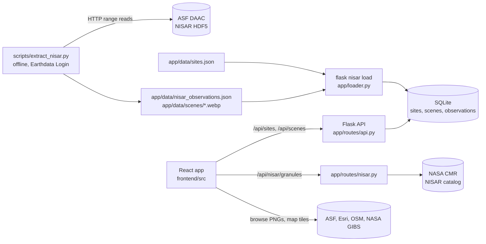

# Guide: NISAR Surface Change Explorer

Start here. It covers getting the app running on your machine, the
NISAR background behind it, the data pipeline, and where everything
lives in the code.

**The challenge** ([_Dancing with the SARs_](https://www.spaceappschallenge.org/2026/challenges/dancing-with-the-sars/)):
build an interactive, open-source app that uses radar data from the
NASA-ISRO Synthetic Aperture Radar (NISAR) mission to track and
visualize one or more types of surface change at locations around the
world (wetlands, wildfires, earthquakes, farming, glaciers, subsidence,
and so on), and make it understandable to a broad audience, with
hypotheses about the physical drivers behind what the radar sees.

---

## 1. Get it running (about 10 minutes)

### Install once

| Tool    | Version | Check with         | Get it                              |
| ------- | ------- | ------------------ | ----------------------------------- |
| Git     | any     | `git --version`    | <https://git-scm.com/downloads>     |
| Python  | 3.11+   | `python --version` | <https://www.python.org/downloads/> |
| Node.js | 22+ LTS | `node --version`   | <https://nodejs.org/>               |

VS Code is recommended but not required. Platform-specific install
steps are in the [macOS](#macos) and [WSL](#windows-wsl-recommended-on-windows)
sections below.

### Clone

```bash
git clone https://github.com/cirillojon/nisar-surface-change-app.git
cd nisar-surface-change-app
```

### macOS

**One-time install** (with [Homebrew](https://brew.sh/)):

```bash
brew install git python@3.12 node
python3.12 --version      # 3.11+ required; macOS's built-in python3 is too old
node --version            # 22+
```

**Terminal 1: backend** (repo root)

```bash
python3.12 -m venv .venv
source .venv/bin/activate
pip install -r requirements.txt -r requirements-dev.txt
cp .env.example .env
flask db upgrade          # creates app-data/data.db
flask nisar load          # loads the 6 study sites from app/data/
bin/start dev             # API on http://localhost:8880
```

**Terminal 2: frontend**

```bash
cd frontend
cp .env.example .env      # optional: the defaults work
npm install
npm run dev               # open http://localhost:5173
```

On later runs, start with `source .venv/bin/activate` in terminal 1 and
then `bin/start dev`. Terminal 2 only needs `npm run dev`.

macOS notes:

- `bin/start` logs `flock unavailable — running without boot lock`.
  That's harmless.
- If you see `bin/start: Permission denied`, run `chmod +x bin/start`.

### Windows: WSL (recommended on Windows)

**One-time WSL setup.** In an _Administrator_ PowerShell, run this and
then reboot:

```powershell
wsl --install -d Ubuntu
```

**One-time tools install.** Open the **Ubuntu** app:

```bash
sudo apt update
sudo apt install -y git python3 python3-venv python3-pip sqlite3 curl
python3 --version         # Ubuntu 24.04 → 3.12 ✓ ; 22.04 → 3.10 (works, CI uses 3.11)

# Node.js 22 via nvm
curl -o- https://raw.githubusercontent.com/nvm-sh/nvm/v0.40.3/install.sh | bash
source ~/.bashrc
nvm install 22
node --version
```

**Clone into your Linux home folder, not `/mnt/c/...`.** Under `/mnt/c`
(including OneDrive folders), `npm install` and the tests run many times
slower, and Vite's hot reload can miss file changes.

```bash
mkdir -p ~/code && cd ~/code
git clone https://github.com/cirillojon/nisar-surface-change-app.git
cd nisar-surface-change-app
code .                    # optional: opens VS Code connected to WSL
```

**Terminal 1: backend**

```bash
python3 -m venv .venv
source .venv/bin/activate
pip install -r requirements.txt -r requirements-dev.txt
cp .env.example .env
flask db upgrade
flask nisar load
bin/start dev             # API on http://localhost:8880
```

**Terminal 2: frontend**

```bash
cd ~/code/nisar-surface-change-app/frontend
cp .env.example .env
npm install
npm run dev
```

Open <http://localhost:5173> in your normal Windows browser. WSL
forwards `localhost` automatically.

WSL notes:

- Install and run everything **inside WSL**. Don't mix with Windows:
  `node_modules` and `.venv` built in WSL won't work from PowerShell, or
  the other way around. If you mix them by accident, delete
  `frontend/node_modules` and `.venv` and reinstall.
- If `bin/start` gives `Permission denied`, run `chmod +x bin/start`.
  If it gives `bash\r: No such file or directory`, run
  `sed -i 's/\r$//' bin/start` (the repo was cloned with Windows line
  endings).
- In VS Code, install the **WSL** extension and open the project with
  `code .` from the Ubuntu terminal.

### Linux

Same as WSL, skipping the WSL install: install Python 3.11+, `python3-venv`,
Node 22+ and git with your package manager, then run the WSL backend and
frontend steps.

### Windows PowerShell

**Terminal 1: backend**

```powershell
py -3.11 -m venv .venv            # or: python -m venv .venv
.venv\Scripts\Activate.ps1
pip install -r requirements.txt -r requirements-dev.txt
Copy-Item .env.example .env
flask db upgrade
flask nisar load
flask run --port 8880 --debug     # bin/start is bash-only; this replaces it
```

If `Activate.ps1` is blocked ("running scripts is disabled"), run
`Set-ExecutionPolicy -Scope CurrentUser RemoteSigned` once and try again.

**Terminal 2: frontend**

```powershell
cd frontend
Copy-Item .env.example .env
npm install
npm run dev
```

> Prefer WSL on Windows (see above). If you switch between PowerShell
> and WSL, delete `frontend/node_modules` and `.venv` and reinstall.

### Check it works

1. <http://localhost:8880/api/health> shows `"status": "ok"` and
   `"site_count": 6`.
2. <http://localhost:5173/workspace> shows the map, with a marker for
   every place and the Stories list beside it.
3. Click **Mexico City**. A red subsidence map appears over the city,
   with a chart dropping to about −200 mm. Press **▶ Play** to watch
   the city sink pass by pass.
4. On the **Investigate** tab, click anywhere on land. A yellow box appears and NISAR catalog
   results for that spot load.

Run the tests, too:

```bash
pytest -q                     # backend (repo root, venv active)
cd frontend && npm test       # frontend
```

### Accounts (only when you need them)

- **NASA Earthdata Login** (free, instant): <https://urs.earthdata.nasa.gov/>.
  Needed to **compute** NISAR values (read the HDF5 files) and to
  download granules. Not needed to run the app, browse images or search
  the catalog. Put it in `~/.netrc` (never in the repo):

  ```bash
  printf 'machine urs.earthdata.nasa.gov login YOUR_USER password YOUR_PASS\n' > ~/.netrc
  chmod 600 ~/.netrc
  ```

---

## 2. What the app does

| Area                 | What you can do                                                                         |
| -------------------- | --------------------------------------------------------------------------------------- |
| Map (right)          | Switch basemaps (top-right): Satellite, Streets, NASA GIBS true color                   |
| Tabs (top)           | **Stories** (a question and hypotheses per place), **Investigate** (every place, drawing, clicking the map), **My findings** (saved evidence cards) |
| Places (Investigate) | One list: study sites **measured over time**, then **before & after** places (lava, ice, rivers, landslides) with a change map; every place is also a marker on the map |
| Under the map        | Time, layer and opacity for whatever is on the map; a before & after place adds a **change map** since a date you pick |
| Drawing (Investigate) | **Draw area** or **Draw line**; a bar over the map says what to do next and has **Undo**, **Finish line** and **Cancel** |
| Getting around       | What you open stays on the map across tabs. A panel's **← All …** link returns to its list and the whole world; **Hide panel** only hides; the top bar's **Workspace** link starts over |
| Site panel           | Site notes, **how radar sees it**, catalog search; NISAR **time-lapse** on the map       |
| Charts               | Click a point to jump the map to that pass                                              |
| NISAR story (beside the map) | The NISAR series, moments that sum it up (they pop up over the map, starting at the first), the site's other NISAR series, and one related series (rain or river flow) right under the NISAR chart; click or drag to change the pass. Drawn areas show rain only next to a measured series (SME2) |
| Live catalog search  | In a site ("Search the live NISAR catalog"), or click anywhere on the map on the Investigate tab |
| Granule list         | Thumbnails, date, quality badge; **Show on map** overlays the browse image; **Download** |

### The six study sites

Everything shown is computed from real NISAR granules by
[`scripts/extract_nisar.py`](../scripts/extract_nisar.py). Nothing is
illustrative.

| Site                     | Change type       | Product | Passes | What NISAR shows                                                                                                 |
| ------------------------ | ----------------- | ------- | ------ | ---------------------------------------------------------------------------------------------------------------- |
| Punjab, India            | Crops & farming   | GCOV    | 26     | HV climbs Nov–Mar, drops 3.8 dB by late April, peaks in Sep; open water on one pass (7 Jul)                      |
| Mekong Delta, Vietnam    | Crops & farming   | GCOV    | 11     | Open water from under 0.5% (Jun–Jul) to 9.6% (11 Sep), still 8.1% at the end of October                          |
| Columbia Basin, WA       | Crops & farming   | GCOV    | 11     | HV peaks in mid-August, then falls 2.6 dB at every pass to late October as circular fields darken                |
| Sylhet haors, Bangladesh | Floods & wetlands | GCOV    | 12     | Open water 53% (14 Jul) to 14% (11 Nov); half the passes see 83% of the box                                      |
| Okavango, Botswana       | Floods & wetlands | GCOV    | 10     | Open water highest on 8 Jul (11%), then falls or holds at every pass to 1.7% (24 Oct)                            |
| Mexico City              | Land subsidence   | GUNW    | 29     | −204 mm relative LOS displacement (negative = away) in a year; fitted pace 20.0 mm/month (Nov–Apr), 14.1 (May–Oct) |

The full stories are the `description` fields in
[`app/data/sites.json`](../app/data/sites.json).

### Caveats

- **Most granules are provisional** (early-mission processing). Each
  pass shows its quality badge.
- **Displacement is line-of-sight** (toward/away from the satellite),
  relative to a stable reference point, and not corrected for
  atmospheric water vapour, so single 12-day steps are noisy.
- **"Open water"** is a simple threshold (HH < −18 dB). Wind-roughened
  water looks brighter and is missed; flooded vegetation looks *bright*
  (double bounce) and is missed too.
- **Site values are medians over the whole site box,** so they show
  broad change, not individual fields.

### Sites we tried and dropped

Other candidate sites were processed and dropped because the real
data didn't support a clear story yet:

- Mississippi Delta and the Palisades burn scar: the water share
  swings with wind on open water.
- Pantanal, Rondônia and Central Kalimantan: their box-wide medians
  are flat. A per-pixel change map would show more.
- Kīlauea: the summit decorrelates (lava, active vents).
- Campi Flegrei: nine passes whose step-to-step noise (14 mm) was larger
  than the mean step (3 mm).
- Lake Mead, Lake Roosevelt and the Imperial Valley (Nov 2026): the
  open-water share swung between passes with no trend, and Imperial's
  HV was flat. Houston subsidence: the extraction failed.
- Svartsengi: atmospheric stripes.
- San Joaquin Valley: no stable reference point nearby.

Glaciers (GOFF) need offset-tracking work. See §6.

---

## 3. NISAR in five minutes

- **What:** a joint NASA–ISRO radar satellite, launched **30 July 2025**
  from Sriharikota, India. It carries two radars: **L-band** (~24 cm
  wavelength, NASA/JPL) and **S-band** (~9.4 cm, ISRO; used mainly over India).
- **Why radar:** it sends its own microwave pulses, so it sees **day or
  night, through clouds and smoke**. L-band also passes through vegetation
  canopy.
- **Orbit repeat:** **12 days**. That is not a guarantee of two acquisitions
  at every location per cycle; local coverage depends on track, acquisition
  plan and look direction. Ascending and descending passes have different
  viewing geometry.
- **Where the data is:** the Alaska Satellite Facility (ASF) DAAC.
  Anyone can search it through NASA's **CMR** catalog (that's what our
  backend does). Downloads need a free Earthdata Login. Files are HDF5
  (`.h5`) and **large**: the app lists GCOV and GUNW granules from a few
  hundred MB to about 6 GB each, and GSLC granules of around 20 GB.

### Products we search

| Code   | Name                             | Measures                                      | Good for                                         |
| ------ | -------------------------------- | --------------------------------------------- | ------------------------------------------------ |
| `GCOV` | Geocoded polarimetric covariance | Calibrated radar brightness (**backscatter**) | Floods, wetlands, fire scars, crops, forest loss |
| `GUNW` | Geocoded unwrapped interferogram | Phase and ancillary layers; infer relative line-of-sight motion | Earthquakes, volcanoes, subsidence |
| `GOFF` | Geocoded pixel offsets           | Image-matched offsets; useful for larger motion | Glaciers, landslides |
| `GSLC` | Geocoded single-look complex     | Complex imagery (amplitude + phase) | Custom processing; search only in this app |
| `SME2` | Soil moisture (Level 3)          | Volumetric retrieval on a 200 m grid (5+5 MHz passes aggregated to 400 m); accuracy goal 0.06 m³/m³ | Agriculture and flood context |

These are product types, not direct physical-motion vectors. This app
currently processes LSAR products only; it does not process SSAR/S-band data.

Each granule carries a **quality** badge: `validated` (science-grade) or
`provisional`/`beta` (earlier processing, many more granules). We search
both kinds and label each result.

### Vocabulary

- **Backscatter (dB):** how much radar energy bounces back. Rough or
  vegetated surfaces are bright, calm water is dark, and flooded forest
  is very bright (double-bounce).
- **Polarization (HH, HV, ...):** send/receive orientation. **HV**
  (cross-pol) is sensitive to vegetation volume, which makes it great for
  forests, crops, and burn scars.
- **InSAR / interferogram:** compares the radar _phase_ of two passes to
  measure ground motion at the mm–cm scale.
- **Line-of-sight (LOS) displacement:** motion toward or away from the
  satellite, not purely up or down.
- **Pixel offsets:** how far image features moved between passes. Used
  when motion is too large for InSAR, like fast glaciers.

---

## 4. How the code fits together



### "I want to..." map

| I want to...                               | Edit                                                                                   |
| ------------------------------------------ | -------------------------------------------------------------------------------------- |
| Add a study site                           | `app/data/sites.json`, then run the extractor (§5) and `flask nisar load --force`      |
| Change a site's story text                 | `description` in `app/data/sites.json`, then `flask nisar load --force`                |
| Compute a new metric (e.g. VV, a ratio)    | `gcov_scene()` in `scripts/extract_nisar.py` + `METRICS` in `app/change_types.py`      |
| Add a change type                          | `app/change_types.py` (the UI picks it up automatically)                               |
| Add or change a site's story (moments)     | `SITE_CHAINS` in `app/chains.py`, then `scripts/build_driver_data.py` (§5)             |
| Add a kind of driver (snowpack, reservoir) | A fetcher and a `KINDS` entry in `app/drivers.py`, a branch in `scripts/build_driver_data.py` |
| Change image colors                       | `STRETCH_DB` / `displacement_rgb()` in `scripts/extract_nisar.py`, then `--refresh`    |
| Search another NISAR product               | `PRODUCTS` in `app/nisar.py`                                                           |
| Add a backend endpoint                     | `app/routes/api.py` + a test in `tests/`                                               |
| Change a DB table                          | `app/models.py`, then `flask db migrate -m "..."` and `flask db upgrade`               |
| Call a new endpoint from the UI            | `frontend/src/services/api.js`                                                         |
| Change the map (layers, markers, overlays) | `frontend/src/components/ChangeMap.jsx`                                                |
| Change the time-lapse / before-after       | `frontend/src/components/ScenePlayer.jsx`                                              |
| Change the site panel / charts             | `SiteDetail.jsx`, `TimeSeriesChart.jsx`                                                |
| Change granule search UI                   | `GranulePanel.jsx`                                                                     |
| Change layout / overall state              | `frontend/src/workspace/WorkspaceApp.jsx`, `frontend/src/index.css`                    |
| Add or change a docs page                  | `frontend/src/content/docs/<tab>/<slug>.mdx` + `frontend/src/platform/docs/nav.js`     |

Try the NISAR search from the terminal (venv active):

```bash
flask nisar search --bbox=-99.3,19.2,-98.9,19.6 --product GUNW --days 60
```

---

## 5. The real data pipeline

The web app never touches HDF5 files. A script computes everything
offline and commits small results; the app just serves them.

### Where everything goes

| What                                           | Where                                  | In git?         |
| ---------------------------------------------- | -------------------------------------- | --------------- |
| Site definitions and stories (hand-edited)     | `app/data/sites.json`                  | Yes             |
| Per-pass values (generated)                    | `app/data/nisar_observations.json`     | Yes             |
| Per-pass images, ~40 KB each (generated)       | `app/data/scenes/<site>/<date>.webp`   | Yes             |
| Pipeline code                                  | `scripts/extract_nisar.py`             | Yes             |
| Cached interferogram pixels                    | `nisar-downloads/cache/`               | No (gitignored) |

### Running it

```bash
pip install -r requirements-data.txt             # h5py, numpy, pyproj, pillow
python scripts/extract_nisar.py                  # every site; skips passes already done
python scripts/extract_nisar.py --site punjab-crop-cycles
python scripts/extract_nisar.py --list-frames --site punjab-crop-cycles
flask nisar load --force                         # put the results in the DB
```

It needs an Earthdata Login in `~/.netrc` (see [Accounts](#accounts-only-when-you-need-them)).
It **never downloads whole files**: it reads only the bytes over each
site through HTTP range requests, about 20 MB per pass. All six sites
take a few minutes. Commit `app/data/` when you're happy with the result.

### What it does

1. **Find granules** in NASA CMR over the site's box, validated and
   provisional collections.
2. **Pick one track/frame** with the most usable passes, so every value
   is seen from the same angle. Mixing ascending and descending passes
   adds fake jumps. Pin one with `"frame"` in `sites.json` if needed.
   Example: Sylhet uses the dawn (descending) pass because evening wind
   roughens the water.
3. **GCOV sites** (backscatter): read HH and HV from **frequency B**
   when both are available in the selected mode. Do not treat frequency
   B as a guarantee of a fixed bandwidth, pixel spacing or polarization
   across modes. Resample
   onto a lat/lon grid over the box, then record median HH/HV in dB and
   the open-water share, and write an RGB image (R = HH, G = HV,
   B = HH/HV, fixed stretches).
4. **GUNW sites** (interferograms): take the longest unbroken chain of
   pairs (the mission's repeat cycle is 12 days; actual pair intervals
   come from the granule dates). For each pair, subtract NISAR's ionosphere
   phase screen and convert phase to mm with −λ/4π (λ = 24.2 cm). We
   checked the sign against known subsidence (Mexico City) and uplift
   (Campi Flegrei): positive = toward the satellite, negative = away. The
   Handbook's general phase equation does not by itself fix the
   product-specific sign. Then subtract the median at the
   stable `reference` point, keeping only pixels in the reference's
   unwrapped connected component, and add up the pairs. Record the
   cumulative value at the site point, and write a red/blue cumulative
   displacement map per date.

### Adding a site

1. Add an entry to `app/data/sites.json`: `slug`, `name`,
   `change_type`, `latitude`/`longitude` (the point charted for GUNW),
   `bbox` (`[W, S, E, N]`, about 0.3–1°), `description`. GUNW sites also
   need `reference: [lon, lat]` on ground that isn't moving.
2. `python scripts/extract_nisar.py --list-frames --site <slug>` to see
   coverage, then run it without `--list-frames`.
3. Look at the images (`app/data/scenes/<slug>/`) and the numbers before
   trusting them. Then write the `description` from what the data
   actually shows, and `flask nisar load --force`.

Mistakes fail loudly: an unknown slug, unknown metric, malformed date or
missing image makes `flask nisar load` exit with an error, and makes
`pytest` (so CI) fail.

### Adding a site story

The panel beside the map leads with the site's NISAR series and sums it
up in a few **moments**. Its content lives in `SITE_CHAINS` in
`app/chains.py`; the related data is a committed snapshot, so no login
or key is needed. The rule: **NISAR first, no causes, no verdicts.**

1. Add an entry for the site's slug: the NISAR metric to chart, any
   related series (`rain` or `river` with a `lat`/`lon`), and 2–5
   `moments`.
2. Each moment is a `start` and `end` **pass date**, a short `title`,
   an optional `season` label (only with a source; Punjab's follow FAO's
   crop calendar), a `stat` (`change`, `rate`, `peak`, `low`, `value`),
   a caption of about ten words and optionally a `related` series id.
   Never type a number into a caption: the app computes and shows the
   number. Describe the series ("HV falls at every pass"), not a cause
   ("the harvest").
3. `python scripts/build_driver_data.py --site <slug>` fetches the
   related series into `app/data/drivers.json`. For a river, check the
   peak it prints is river-sized: a point a few kilometers off lands on
   a side stream. Restart the backend afterwards; it reads the snapshot
   once.
4. Add a check to `test_committed_captions_describe_the_data` in
   `tests/test_chains.py` for anything a caption asserts (the biggest
   drop, falling at every pass). `pytest tests/test_chains.py` also
   fails if a moment's dates stop being passes after new data.
5. `python scripts/chain_evidence.py --write` refreshes the tables in
   [`DATA_AND_METHODS.md`](DATA_AND_METHODS.md). Then add the site to
   that document's "Site by site" section, and a row to its background
   table for any sentence in the `description` that the data doesn't
   show, with its source.

Daily rain names its weather model in every request (`RAIN_MODEL` in
`app/drivers.py`); a "% of normal" uses ERA5 on both sides. Don't
compare totals across the two.

### Opening a granule yourself

To explore beyond the script (a notebook is ideal):

```python
import h5py, requests, sys
sys.path.insert(0, "scripts")
from extract_nisar import RangeFile          # range-request file object

url = "https://nisar.asf.earthdatacloud.nasa.gov/NISAR/..."   # a granule's data_url
f = h5py.File(RangeFile(url, requests.Session()), "r")
f.visit(print)                                 # layout differs by product
```

Useful paths: GCOV `/science/LSAR/GCOV/grids/frequency{A,B}/{HHHH,HVHV,mask,...}`
(the pipeline reads the stored linear-power layers and converts them to dB; it
does not apply an extra sigma-zero/gamma-zero conversion or terrain flattening), GUNW
`/science/LSAR/GUNW/grids/frequencyA/unwrappedInterferogram/HH/{unwrappedPhase,ionospherePhaseScreen,connectedComponents,coherenceMagnitude}`.
Product specs are linked from <https://nisar-docs.asf.alaska.edu/>.
**Never commit `.h5` files.**

---

## 6. What's next

Shipped: six study sites, the land-change gallery with per-pixel change
maps, drawn areas (including SME2 soil moisture), height profiles along
a line, site stories with related series, shareable URLs and a guided
tour. Not done yet:

- Glaciers from **GOFF** offsets (Jakobshavn has coverage); today GOFF
  is searchable only.
- Better InSAR for the site series: tropospheric correction, coherence
  masking, and vertical vs. line-of-sight using both tracks.
- More polarizations: VV and quad-pol where frequency A has them.
- More ancillary layers: optical imagery (Sentinel-2) and population.
- A second year of passes, to tell seasonal change from one-off change.

---

## 7. Contributing

Branch, test and pull-request conventions are in
[CONTRIBUTING.md](../CONTRIBUTING.md). In short:

- Branch off `main`. CI runs backend tests, frontend tests, lint, build
  and a schema-drift check on every pull request.
- Changed a model? Run `flask db migrate -m "..."` and commit the new
  file in `app/migrations/versions/`.
- Don't commit `.env`, `.netrc`, `*.db`, `*.h5` or `nisar-downloads/`
  (all gitignored already). Do commit `app/data/` after running the
  extractor.

### Commands

| Task                             | Command                                                                |
| -------------------------------- | ---------------------------------------------------------------------- |
| Backend tests                    | `pytest -q`                                                            |
| Frontend tests                   | `cd frontend && npm test`                                              |
| Frontend lint                    | `cd frontend && npm run lint`                                          |
| Recompute NISAR data             | `python scripts/extract_nisar.py [--site <slug>]` (needs `~/.netrc`)   |
| Reload site data into the DB     | `flask nisar load --force`                                             |
| Search NISAR from terminal       | `flask nisar search --bbox=W,S,E,N --product GCOV`                     |
| Reset local DB                   | delete `app-data/data.db`, then `flask db upgrade && flask nisar load` |
| New migration                    | `flask db migrate -m "describe change"`                                |

### Quick fixes

| Symptom                                      | Fix                                                                                                                    |
| -------------------------------------------- | ---------------------------------------------------------------------------------------------------------------------- |
| Site list is empty                           | Run `flask nisar load`                                                                                                 |
| Pulled new data but the app didn't change    | Run `flask nisar load --force` (or restart `bin/start dev`), then refresh the page                                     |
| Extractor says `HTTP 401` / check `~/.netrc` | Earthdata Login missing or wrong in `~/.netrc` (format in §1 Accounts)                                                 |
| "Image position is approximate" on a granule | Exact image bounds are public only for validated data, and that frame has none yet. The image can sit up to ~30 km off |
| "Can't reach the backend" in the UI          | Backend not running on :8880, or `VITE_PROXY_URL` in `frontend/.env` is wrong                                          |
| "NASA CMR search is unavailable" (502)       | CMR or your network hiccupped; retry. Results are cached for 10 min once they load.                                    |
| No granules for a spot                       | Widen the date range, or try another product. GUNW/GOFF coverage is sparser than GCOV                                  |
| "Download .h5" asks for a login              | Expected: sign in with your Earthdata Login                                                                            |
| `flask: command not found`                   | Activate the venv first                                                                                                |
| `429 Rate limit exceeded` while hacking      | Set `RATELIMIT_ENABLED=false` in `.env`, then restart the backend                                                      |

More in [TROUBLESHOOTING.md](TROUBLESHOOTING.md).

---

## 8. Links

- The challenge: <https://www.spaceappschallenge.org/2026/challenges/dancing-with-the-sars/>
- NISAR Data User Guide (ASF): <https://nisar-docs.asf.alaska.edu/>
- NISAR mission (JPL): <https://nisar.jpl.nasa.gov/>
- ASF Vertex (browse/download NISAR data in a UI): <https://search.asf.alaska.edu/>
- NASA Earthdata Search: <https://search.earthdata.nasa.gov/search>
- Earthdata Login: <https://urs.earthdata.nasa.gov/>
- NASA CMR search API: <https://cmr.earthdata.nasa.gov/search/site/docs/search/api.html>
- Intro to SAR (Earthdata): <https://www.earthdata.nasa.gov/learn/earth-observation-data-basics/sar>
- NISAR StoryMaps (inspiration): <https://nisar.jpl.nasa.gov/applications/arcgis-storymaps/>
- NASA ARSET trainings (SAR, NISAR): <https://appliedsciences.nasa.gov/get-involved/training>
